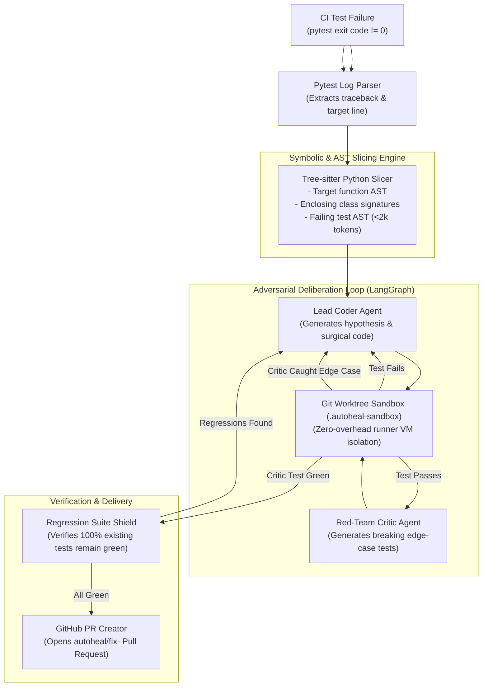

# 🩺 AutoHeal-CI

> **Autonomous Multi-Agent CI/CD Self-Healing Bot with AST-Aware Slicing, Isolated Sandbox Verification & Regression Shielding.**

[-brightgreen.svg)](#тестирование-и-верификация)
[](#-архитектура-системы)
[](#1-ast--symbolic-call-graph-slicing-tree-sitter)
[](#-быстрый-старт-в-github-actions)
[](#-лицензия)

---

## 📌 О проекте

В современных IT-командах до 35% времени Senior/Staff инженеров уходит на рутинный разбор упавших сборок в CI/CD: отлов flaky-тестов, поиск мест ошибок по простыням логов, написание банальных заплаток и ручное создание Pull Request.

**AutoHeal-CI** — это автономная мультиагентная система, работающая прямо внутри GitHub Actions Runner на шаге `if: failure()`. 
Она локализует причину сбоя с помощью синтаксического анализа AST-графов Tree-sitter, воспроизводит ошибку в изолированном `git worktree`, проводит внутренние состязательные дебаты («Coder» vs «Red-Team Critic») и отправляет проверенный PR с новым регрессионным тестом **до того, как разработчик успел открыть лог CI**.

---

## 🚀 Быстрый старт в GitHub Actions

Добавьте шаг в ваш файл воркфлоу `.github/workflows/ci.yml`:

```yaml
name: CI Suite

on: [push, pull_request]

jobs:
  test:
    runs-on: ubuntu-latest
    permissions:
      contents: write
      pull-requests: write

    steps:
      - name: Checkout Code
        uses: actions/checkout@v4
        with:
          fetch-depth: 0

      - name: Set up Python
        uses: actions/setup-python@v5
        with:
          python-version: '3.11'

      - name: Install Dependencies
        run: pip install -e .[dev]

      - name: Run Tests
        run: pytest -v

      # Запускается только при падении предыдущих тестов
      - name: AutoHeal-CI Self-Healing Bot
        if: failure()
        uses: ./
        with:
          api_key: ${{ secrets.OPENAI_API_KEY }} # или ANTHROPIC_API_KEY / GEMINI_API_KEY
          model: 'gpt-4o'
          max_rounds: '3'
          create_pr: 'true'
```

---

## 🏗️ Архитектура системы



---

## ⚡ Ключевые инженерные преимущества

### 1. AST & Symbolic Call-Graph Slicing (Tree-sitter)
Вместо неточного векторного RAG или заливки сотен строк файла в промпт, `tree-sitter-python` хирургически извлекает минимальный семантический срез:
* Точное тело упавшей функции;
* Сигнатуры смежных методов класса (типы и контракты без реализации);
* Тело упавшего теста.  
Контекст составляет **<2,000 токенов**, исключая галлюцинации LLM.

### 2. Состязательный цикл (Coder vs Red-Team Critic)
Решает фундаментальную академическую проблему Automated Program Repair (APR) — **переобучение тестового сьюта (Overfitting)**:
* Coder пишет минимальный diff;
* Critic не верит решению и генерирует экстремальный контр-тест (`pytest.mark.parametrize`, граничные значения, `None`, деление на 0);
* Патч утверждается, только когда Critic не может его опровергнуть.

### 3. Изоляция в Git Worktree (Zero Infrastructure Overhead)
* Бот создает временный `git worktree add --detach .autoheal-sandbox HEAD`.
* Использует виртуальное окружение, уже развернутое на runner'е.
* Запуск тестов занимает секунды без тяжелого Docker-in-Docker.

### 4. Zero Data Leakage (Local-First Security)
Код клиента не отправляется на сторонние SaaS-бэкенды. Бот выполняется внутри изолированной виртуальной машины заказчика в GitHub Actions по модели BYOK (Bring Your Own Key).

---

## 💻 Локальный запуск и CLI

Установка в режиме разработки:
```bash
git clone https://github.com/auto-heal-ci/auto-heal-ci.git
cd auto-heal-ci
pip install -e .[dev]
```

Запуск самолечения локально:
```bash
# Автоматический запуск тестов и исправление первого сбоя
auto-heal --repo-path .

# Запуск по сохраненному логу падения
auto-heal --log-file failure.log --repo-path .
```

---

## 🧪 Тестирование и верификация

Тестовый сьют полностью покрывает парсеры логов, AST-слайсер на Tree-sitter, изоляцию в Git Worktree, LangGraph StateGraph и CLI:

```bash
pytest -v
```

Вывод:
```text
tests/test_ast_slicer.py::test_ast_slice_method_inside_class PASSED      [ 14%]
tests/test_ast_slicer.py::test_ast_slice_standalone_function PASSED      [ 28%]
tests/test_cli.py::test_cli_all_tests_passing PASSED                    [ 42%]
tests/test_cli.py::test_cli_with_log_file_mock PASSED                   [ 57%]
tests/test_graph_deliberation.py::test_full_orchestrator_graph_cycle PASSED [ 71%]
tests/test_pytest_parser.py::test_parse_pytest_failure PASSED            [ 85%]
tests/test_sandbox_worktree.py::test_sandbox_create_and_run PASSED       [100%]
======================= 7 passed in 4.05s =======================
```

---

## 📁 Структура проекта

```text
auto-heal-ci/
├── .github/
│   └── workflows/
│       └── self-heal-ci.yml           # Пример GitHub Actions пайплайна
├── action.yml                         # Метаданные GitHub Action
├── pyproject.toml                     # Зависимости и конфигурация pytest
├── README.md                          # Документация проекта
├── src/
│   └── autoheal/
│       ├── __init__.py
│       ├── cli.py                     # CLI точка входа
│       ├── config.py                  # Pydantic настройки и переменные окружения
│       ├── parsers/
│       │   ├── pytest_log_parser.py   # Регулярный парсер логов pytest
│       │   └── ast_slicer.py          # Tree-sitter AST анализатор кода
│       ├── sandbox/
│       │   └── git_worktree.py        # Изолированный Sandbox Harness
│       ├── agents/
│       │   ├── state.py               # AutoHealState схема для LangGraph
│       │   ├── llm_client.py          # Unified BYOK адаптер (OpenAI / Claude / Gemini)
│       │   ├── coder_agent.py         # Coder агент
│       │   ├── critic_agent.py        # Red-Team Critic агент
│       │   └── graph.py               # Состязательный LangGraph StateGraph
│       └── delivery/
│           └── github_pr.py           # Создание веток, коммитов и Pull Requests
└── tests/
    ├── test_ast_slicer.py
    ├── test_cli.py
    ├── test_graph_deliberation.py
    ├── test_pytest_parser.py
    └── test_sandbox_worktree.py
```

---

## 📄 Лицензия

Распространяется под лицензией **Apache-2.0**.
