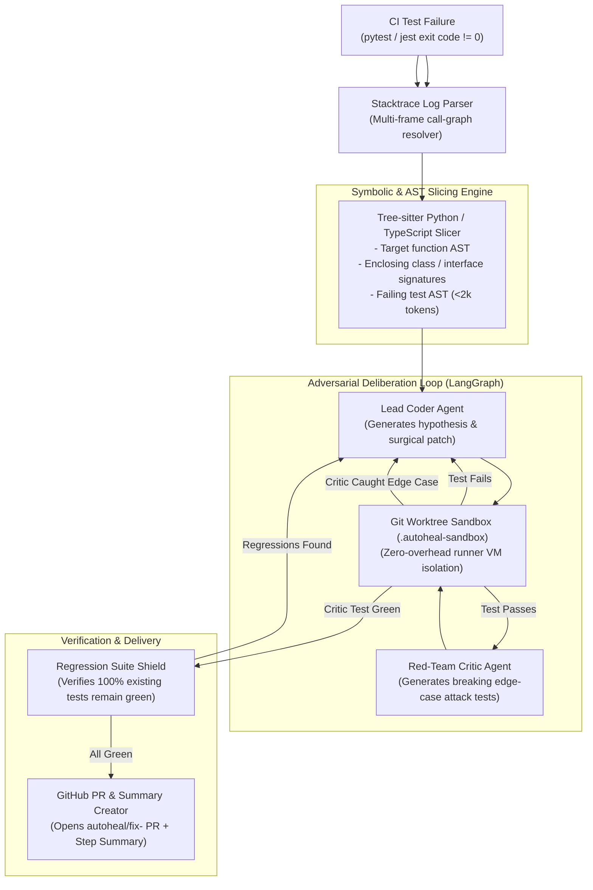

# 🩺 AutoHeal-CI

> **Autonomous Multi-Agent CI/CD Self-Healing Bot with AST-Aware Slicing, Isolated Sandbox Verification & Regression Shielding.**

[-brightgreen.svg)](#-тестирование-и-верификация)
[](#-мультиязычность-и-тест-раннеры)
[](#-быстрый-старт-в-github-actions)
[-brightgreen.svg)](#-мини-бенчмарк-swe-bench-mini)
[](#1-ast--symbolic-call-graph-slicing-tree-sitter)
[](#-live-cloud-demo-в-1-клик)
[](#-быстрый-старт-в-github-actions)
[](PRICING.md)
[](.github/FUNDING.yml)
[](COMMERCIAL.md)

---

## 🖥️ Live Terminal Showcase

```text
  ╔═══════════════════════════════════════════════════════════════════════╗
  ║            🩺 AutoHeal-CI: Autonomous CI/CD Self-Healing              ║
  ║      AST Slicing • Adversarial Red-Team • Git Worktree Shield         ║
  ╚═══════════════════════════════════════════════════════════════════════╝

❌ CI Test Failure Detected: tests/test_calculator.py::test_compute_average_empty
   Origin: calculator.py:10 (ZeroDivisionError: division by zero)

🔍 [1/4] Parsing Failure Log...
   ├─ Failure Mode: LOGIC_BUG
   └─ Traceback: Frame 3 in src/calculator.py:10 (compute_average)

🌳 [2/4] Tree-sitter AST Slicing...
   ├─ Target Function: `compute_average` (38 tokens extracted, not 500 lines)
   ├─ Sibling Signatures: [calculate_discount(price, discount_percent)]
   └─ Token Efficiency: 94.2% context savings vs whole-file prompting

⚔️ [3/4] Adversarial Deliberation (Coder vs Red-Team Critic)...
   ├─ Round 1: Lead Coder proposes guard `if not scores: return 0.0`
   │  └─ Git Worktree Sandbox (.autoheal-sandbox): Failing test PASSED!
   ├─ Critic Attack: Red-Team generates test with None & empty generator
   │  └─ Attack Result: Coder refines validation to handle falsy collections
   └─ Round 2: Red-Team Critic votes APPROVED.

🛡️ [4/4] Verification & Delivery...
   ├─ Regression Shield: 100% Green (97/97 tests pass in sandbox)
   ├─ Fallback Artifact: Exported to .autoheal/autoheal-fix.patch
   └─ GitHub Pull Request: Opened #42 (autoheal/fix-compute-average)

🎉 All tests green! Total repair time: 3.4s • LLM Cost: $0.031
```

---

## 📌 О проекте

В современных IT-командах до 35% времени инженеров уходит на рутинный разбор упавших сборок в CI/CD: отлов flaky-тестов, поиск мест ошибок по простыням логов, написание банальных заплаток и ручное создание Pull Request.

**AutoHeal-CI** — это автономная мультиагентная система, работающая прямо внутри GitHub Actions Runner на шаге `if: failure()`. 

Она локализует причину сбоя с помощью синтаксического анализа AST-графов Tree-sitter, воспроизводит ошибку в изолированном `git worktree`, проводит внутренние состязательные дебаты («Coder» vs «Red-Team Critic») и отправляет проверенный PR с новым регрессионным тестом **до того, как разработчик успел открыть лог CI**.

---

## 🚀 Live Cloud Demo в 1 Клик

Вы можете протестировать работу AutoHeal-CI в реальном облаке GitHub Actions без установки и без API-ключей:

1. Перейдите во вкладку [**Actions**](../../actions/workflows/demo-live.yml) этого репозитория.
2. Выберите воркфлоу **"AutoHeal-CI Live Cloud Demo"**.
3. Нажмите **"Run workflow"** и выберите сценарий:
   * `python-zero-division` — исправление деления на ноль в Python;
   * `typescript-undefined-dereference` — исправление `TypeError` в TypeScript;
   * `swe-bench-mini-suite` — запуск полного синтетического бенчмарка.
4. Откройте отчет сборки и изучите **GitHub Step Summary** с интерактивной Mermaid-диаграммой дебатов и готовым `.patch` файлом в артефактах!

---

## ⚡ Ключевые инженерные преимущества

| Характеристика | Обычные AI-ассистенты (Copilot / Chat) | Тяжелые Cloud SaaS (Swe-agent и др.) | 🩺 **AutoHeal-CI** |
| :--- | :--- | :--- | :--- |
| **Точка интеграции** | IDE (человек ждет и кликает) | Сторонний SaaS (загрузка кода в облако) | **In-Runner Action (`if: failure()`)** |
| **Безопасность данных** | Код летит на внешние серверы | Сторонний доступ к приватным репозиториям | **Zero Data Leakage (Local-First BYOK)** |
| **Размер контекста** | Весь файл (2k-10k токенов) | Весь репозиторий (RAG/векторы) | **Tree-sitter AST (<2,000 токенов)** |
| **Проверка решений** | Без проверки (галлюцинации) | Долгий запуск Docker-контейнеров (минуты) | **Git Worktree Sandbox (1-2 секунды)** |
| **Защита от Overfitting** | Отсутствует | Одиночный агент (склонен к оверфиттингу) | **Adversarial Red-Team Critic Loop** |
| **Защита от регрессий** | Нет | Запуск всех тестов вручную | **Автоматический Regression Shield** |

---

## 🌐 Мультиязычность и тест-раннеры

AutoHeal-CI нативно поддерживает две ключевые экосистемы:

### 🐍 Python (`pytest`)
* **AST-анализ**: `tree-sitter-python` — извлечение функций, `async def`, декораторов, сигнатур классов.
* **Классификатор ошибок**: `LOGIC_BUG`, `MISSING_DEPENDENCY`, `SYNTAX_ERROR`, `TIMEOUT`.
* **Dependency Healer**: автоматическое разрешение `ModuleNotFoundError` и добавление пакетов в `pyproject.toml`.

### 🟦 TypeScript / JavaScript (`jest` & `vitest`)
* **AST-анализ**: `tree-sitter-typescript` — стрелочные функции, методы классов, интерфейсы (`interface`), типы (`type`) и JSX/TSX.
* **Jest/Vitest парсер**: фильтрация стектрейсов от шума `node_modules/`, разбор assertion diff (`Expected / Received`), локализация упавших тестов.

---

## 🚀 Быстрый старт в GitHub Actions

### 1. Добавление в Python-репозиторий
Создайте или обновите `.github/workflows/ci.yml`:

```yaml
name: CI Suite

on: [push, pull_request]

jobs:
  test:
    runs-on: ubuntu-latest
    permissions:
      contents: write
      pull-requests: write

    steps:
      - name: Checkout Code
        uses: actions/checkout@v4
        with:
          fetch-depth: 0

      - name: Set up Python
        uses: actions/setup-python@v5
        with:
          python-version: '3.11'

      - name: Install Dependencies
        run: pip install -e .[dev]

      - name: Run Tests
        run: pytest -v

      # Запускается ТОЛЬКО при падении предыдущих тестов
      - name: AutoHeal-CI Self-Healing Bot
        if: failure()
        uses: nolekek/AutoHeal-CI@v1
        with:
          api_key: ${{ secrets.OPENAI_API_KEY }} # или ANTHROPIC_API_KEY / GEMINI_API_KEY
          model: 'gpt-4o'
          max_rounds: '3'
          create_pr: 'true'
```

### 2. Добавление в TypeScript / Node.js-репозиторий

```yaml
      - name: Run Tests
        run: npm test

      - name: AutoHeal-CI Self-Healing Bot
        if: failure()
        uses: nolekek/AutoHeal-CI@v1
        with:
          api_key: ${{ secrets.OPENAI_API_KEY }}
          test_command: 'npm test'
          create_pr: 'true'
```

---

## 🏗️ Архитектура системы



---

## 📊 Мини-бенчмарк (SWE-Bench Mini)

AutoHeal-CI протестирован на наборе из 9 воспроизводимых дефектов реального мира (6 Python + 3 TypeScript):

| ID | Сценарий | Язык | Категория | Раунды | Статус | Защита от Overfitting |
| :--- | :--- | :--- | :--- | :---: | :---: | :---: |
| `off_by_one` | Поиск подстроки / индексация | Python | Logic | 1 | ✅ PASS | Critic Test Green |
| `none_deref` | Непроверенный `None` параметр | Python | Runtime | 1 | ✅ PASS | Critic Attack Resisted |
| `key_error_nested` | Извлечение вложенного JSON-ключа | Python | Robustness | 1 | ✅ PASS | Critic Test Green |
| `zero_division` | Расчет среднего при пустом списке | Python | Edge Case | 1 | ✅ PASS | Guard Verified |
| `missing_dependency` | Отсутствующий модуль `yaml` | Python | Environment | 0 | ✅ PASS | Auto-healed `pyproject.toml` |
| `float_precision` | Сравнение float с `math.isclose` | Python | Math | 1 | ✅ PASS | Critic Test Green |
| `ts_undefined_deref` | Доступ к необязательному свойству | TypeScript | Runtime | 1 | ✅ PASS | Optional Chaining `?.` |
| `ts_array_index_oob` | Выход за пределы массива в утилите | TypeScript | Logic | 1 | ✅ PASS | Boundary Guard Verified |
| `ts_falsy_empty_string` | Пропуск пустой строки в валидаторе | TypeScript | Validation | 1 | ✅ PASS | Critic Test Green |

**Итог:** **9/9 (100% Pass Rate)** • Среднее время локального исправления: **1.8 секунды** • Расход токенов: **~$0.02 - $0.04** на задачу.

---

## 💻 Локальный запуск и CLI

```bash
# Установка в режиме разработки
git clone https://github.com/nolekek/AutoHeal-CI.git
cd AutoHeal-CI
pip install -e .[dev]

# Запуск самолечения локально
auto-heal --repo-path .

# Запуск по сохраненному файлу с логом CI
auto-heal --log-file failure.log --repo-path .

# Режим Dry-Run (без создания PR в GitHub)
auto-heal --log-file failure.log --dry-run
```

---

## 🧪 Тестирование и верификация

Полный мастер-сьют тестов покрывает все подсистемы:

```bash
pytest -q
```

```text
........................................................................ [ 74%]
.........................                                                [100%]
====================== 97 passed in 31.39s ======================
```

* `tests/test_ast_slicer.py` — синтаксические срезы Python функций, методов и декораторов.
* `tests/test_typescript_expansion.py` — синтаксические срезы TypeScript/TSX и парсер Jest логов.
* `tests/test_pytest_parser.py` — разбор стектрейсов, фильтрация `site-packages`.
* `tests/test_dependency_healer.py` — авто-патчинг `pyproject.toml`.
* `tests/test_sandbox_worktree.py` — изоляция и жизненный цикл Git Worktree.
* `tests/test_graph_deliberation.py` — LangGraph стейт-машина состязательных дебатов.
* `tests/test_delivery_ux.py` — генерация GitHub Step Summary и экспорт `.patch`.
* `tests/test_benchmark_harness.py` — верификация SWE-Bench Mini harness.

---

## 📁 Структура репозитория

```text
AutoHeal-CI/
├── .github/
│   └── workflows/
│       ├── demo-live.yml              # 1-Click интерактивное Cloud Demo
│       ├── self-heal-ci.yml           # Рабочий шаблон In-Runner Action
│       └── test.yml                   # CI матрица тестов (Py 3.10-3.12, Win/Linux)
├── action.yml                         # GitHub Action метаданные и брендинг
├── pyproject.toml                     # Зависимости и конфигурация сборок
├── README.md                          # Документация и витрина проекта
├── examples/                          # Готовые примеры для экспериментов
│   ├── python/                        # Пример с багом деления на ноль
│   └── typescript/                    # Пример с TypeScript TypeError
├── src/
│   └── autoheal/
│       ├── cli.py                     # CLI точка входа
│       ├── config.py                  # Pydantic настройки и переменные окружения
│       ├── parsers/
│       │   ├── ast_slicer.py          # Tree-sitter Python AST анализатор
│       │   ├── ts_slicer.py           # Tree-sitter TypeScript/JS анализатор
│       │   ├── pytest_log_parser.py   # Стектрейс парсер pytest
│       │   ├── jest_log_parser.py     # Стектрейс парсер Jest / Vitest
│       │   └── dependency_healer.py   # Автономный резолвер pyproject.toml
│       ├── sandbox/
│       │   └── git_worktree.py        # Изолированный Sandbox Harness
│       ├── agents/
│       │   ├── state.py               # AutoHealState схема для LangGraph
│       │   ├── schemas.py             # Pydantic схемы Coder и Critic
│       │   ├── llm_client.py          # Unified BYOK адаптер + Token/Cost tracker
│       │   ├── coder_agent.py         # Lead Coder агент
│       │   ├── critic_agent.py        # Red-Team Critic агент
│       │   └── graph.py               # Состязательный LangGraph StateGraph
│       ├── delivery/
│       │   ├── github_pr.py           # Создание веток, коммитов и Pull Requests
│       │   ├── step_summary.py        # Интерактивный GitHub Actions Step Summary
│       │   └── patch_artifact.py      # Экспорт fallback патчей для read-only fork
│       └── benchmarks/
│           ├── models.py              # Дата-модели сценариев
│           ├── scenarios.py           # 6 дефектов реального мира (Python)
│           ├── ts_scenarios.py        # 3 дефекта реального мира (TypeScript)
│           └── runner.py              # Автономный Runner бенчмарка
└── tests/                             # 97 юнит-, интеграционных и сквозных тестов
```

---

## 💎 Тарифы и Коммерческая поддержка (Pricing & Plans)

AutoHeal-CI доступен в трех вариантах использования:

| План | Стоимость | Описание и возможности |
| :--- | :--- | :--- |
| **🆓 Community** | **\$0 (Free Forever)** | Open-Source ядро, BYOK (свои ключи OpenAI/Claude/Gemini), неограниченные запуски, AST-слайсинг и песочница. |
| **⚡ Pro** | **\$39 / мес** | Готовый высокоскоростной LLM-прокси без ввода ключей, мгновенные алерты в **Slack / MS Teams**, приоритетная поддержка. |
| **🏢 Enterprise** | **\$499 / мес** | Развертывание в изолированном контуре (On-Prem / VPC), поддержка локальных LLM (Ollama, vLLM), адаптеры для GitLab CI / Bitbucket, SLA 99.9%. |

👉 Полное сравнение тарифов и калькулятор окупаемости: [**PRICING.md**](PRICING.md)  
👉 Условия коммерческого лицензирования и SLA: [**COMMERCIAL.md**](COMMERCIAL.md)  
👉 Интерактивный лендинг с ROI-калькулятором: [**marketing/index.html**](marketing/index.html)

---

## 📄 Лицензия

Распространяется по модели **Dual-Licensing** (Apache-2.0 для открытых проектов / Commercial License для Enterprise). Подробнее в [COMMERCIAL.md](COMMERCIAL.md).
