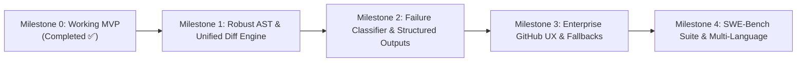

# 🗺️ AutoHeal-CI — Engineering Roadmap

> **Target**: Transforming the MVP into a production-grade, enterprise-ready CI/CD self-healing platform.

---

## 📌 Milestones Overview

---

## 🎯 Milestone 1: Robust AST & Unified Diff Engine
- [ ] **1.1. Multi-Frame Call-Graph Resolver**:
  - Traverse all project-internal frames in the stacktrace (filtering out `site-packages` / system libs) to locate the root cause file/function.
- [ ] **1.2. AST-Based Unified Diff Generator**:
  - Generate standards-compliant unified git diffs (`git apply` compatible) preserving line endings, comments, and project formatting.
- [ ] **1.3. Complex Syntax Support**:
  - Advanced Tree-sitter queries for async functions, decorators, class hierarchies, and type annotations.

---

## 🎯 Milestone 2: Failure Classifier & Structured Multi-Agent Deliberation
- [x] **2.1. Pydantic Structured Outputs**:
  - Strict JSON schema responses for Coder and Critic agents (`CoderPatchOutput`, `CriticAttackOutput`) with robust fallback to markdown parsing.
- [x] **2.2. Pre-Flight Failure Classifier & Auto-Healer**:
  - Categorize failures before running LLM:
    * `LOGIC_BUG`: Run Coder vs Critic loop.
    * `MISSING_DEPENDENCY`: Detect missing packages (`ModuleNotFoundError`) and patch `pyproject.toml` directly via `DependencyHealer`.
- [x] **2.3. Token & Cost Guardrails**:
  - Token tracking, multi-model USD cost calculation, and hard budget limit enforcement (`BudgetExceededError`).

---

## 🎯 Milestone 3: Enterprise GitHub UX & Security
- [ ] **3.1. Rich GitHub Step Summary**:
  - Collapsible `
` blocks with Mermaid diagrams of agent deliberation and side-by-side diff previews.
- [ ] **3.2. Fork PR & Read-Only Fallbacks**:
  - Upload `.patch` artifacts if `GITHUB_TOKEN` lacks write permissions for forked PRs.
- [ ] **3.3. Configurable PR Reviewers & Draft PR Mode**:
  - Open Draft PRs or auto-assign code reviewers.

---

## 🎯 Milestone 4: Verification Benchmark Suite & Multi-Language
- [ ] **4.1. Mini SWE-Bench Test Suite**:
  - 15 reproducible real-world bugs to benchmark healing accuracy.
- [ ] **4.2. TypeScript / Jest AST Extension**:
  - Modular parser architecture extending Tree-sitter to JavaScript/TypeScript and Jest/Vitest runners.
