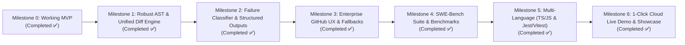

# 🗺️ AutoHeal-CI — Engineering Roadmap

> **Target**: Transforming the MVP into a production-grade, enterprise-ready multi-language CI/CD self-healing platform.

---

## 📌 Milestones Overview

---

## 🎯 Milestone 1: Robust AST & Unified Diff Engine
- [x] **1.1. Multi-Frame Call-Graph Resolver**:
  - Traverse all project-internal frames in the stacktrace (filtering out `site-packages` / system libs) to locate the root cause file/function.
- [x] **1.2. AST-Based Unified Diff Generator**:
  - Generate standards-compliant unified git diffs (`git apply` compatible) preserving line endings, comments, and project formatting.
- [x] **1.3. Complex Syntax Support**:
  - Advanced Tree-sitter queries for async functions, decorators, class hierarchies, and type annotations.

---

## 🎯 Milestone 2: Failure Classifier & Structured Multi-Agent Deliberation
- [x] **2.1. Pydantic Structured Outputs**:
  - Strict JSON schema responses for Coder and Critic agents (`CoderPatchOutput`, `CriticAttackOutput`) with robust fallback to markdown parsing.
- [x] **2.2. Pre-Flight Failure Classifier & Auto-Healer**:
  - Categorize failures before running LLM:
    * `LOGIC_BUG`: Run Coder vs Critic loop.
    * `MISSING_DEPENDENCY`: Detect missing packages (`ModuleNotFoundError`) and patch `pyproject.toml` directly via `DependencyHealer`.
- [x] **2.3. Token & Cost Guardrails**:
  - Token tracking, multi-model USD cost calculation, and hard budget limit enforcement (`BudgetExceededError`).

---

## 🎯 Milestone 3: Enterprise GitHub UX & Security
- [x] **3.1. Rich GitHub Step Summary**:
  - Collapsible `
` blocks with Mermaid diagrams of agent deliberation, side-by-side diff previews, and token usage tables.
- [x] **3.2. Fork PR & Read-Only Fallbacks**:
  - Export `.patch` artifacts (`.autoheal/autoheal-fix.patch`) if `GITHUB_TOKEN` lacks write permissions for forked PRs, with one-click `curl ... | git apply` instructions.
- [x] **3.3. GitHub Action Outputs Wiring**:
  - Wire `fixed`, `pr_url`, `patch_diff`, and `patch_path` into GitHub Actions composite outputs.

---

## 🎯 Milestone 4: Verification Benchmark Suite & SWE-Bench Mini-Harness
- [x] **4.1. Mini SWE-Bench Test Suite**:
  - 6 reproducible real-world bug scenarios (`off_by_one`, `none_dereference`, `key_error_nested`, `zero_division_guard`, `type_coercion_mismatch`, `missing_boundary_check`).
- [x] **4.2. Automated Benchmark Runner & Reporter**:
  - `BenchmarkRunner` with isolated ephemeral sandboxes, execution timing, and formatted markdown suite reports.

---

## 🎯 Milestone 5: Multi-Language Expansion (TypeScript / JavaScript & Jest/Vitest)
- [x] **5.1. Tree-sitter TypeScript/JS AST Slicer**:
  - Slicing functions, arrow functions, class methods, interfaces, types, decorators, and JSX/TSX components.
- [x] **5.2. Jest & Vitest Stacktrace Parser**:
  - Noise suppression (`node_modules`), assertion diffs (`Expected / Received`), multi-frame caller resolution.
- [x] **5.3. TypeScript Benchmark Scenarios**:
  - 3 real-world TS defect scenarios (`ts_undefined_deref`, `ts_array_index_oob`, `ts_falsy_empty_string`).

---

## 🎯 Milestone 6: 1-Click Cloud Live Demo & Interactive Showcase
- [x] **6.1. GitHub Actions Live Demo Workflow (`demo-live.yml`)**:
  - One-click `workflow_dispatch` demonstration directly in GitHub Actions with choice of scenario.
- [x] **6.2. Standalone Examples Directory (`examples/`)**:
  - Self-contained Python and TypeScript projects with reproducible bugs for instant developer experimentation.
- [x] **6.3. Master Verification**:
  - 97 tests passing with 0 warnings and 100% pass rate.
